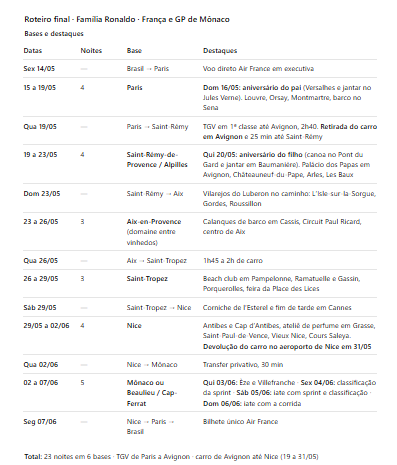

# Roteiro final · Família Ronaldo Moreira · França (Provence + Côte d'Azur) e GP de Mônaco

> Documento-base para a proposta LusaTravel. Transcrição fiel das duas telas recebidas
> + premissas do cliente + checagem técnica + pendências. **Nada reservado, apenas cotado.**

---

## 1. Briefing do cliente

| Item | Informação |
|---|---|
| Cliente | **RONALDO MOREIRA** |
| Viajantes | **4 pessoas:** Ronaldo (pai) + esposa (mãe) + filho de 19 anos + filho de 16 anos — *nome da esposa a confirmar* |
| Tarifação | 4 tarifas de adulto no aéreo (a partir de 12 anos, a tarifa é de adulto) · hotéis para 4 adultos em termos de ocupação |
| Ida | Sex 14/05/2027 (embarque à noite) |
| Volta | Seg 07/06/2027 |
| Duração | 25 dias · 23 noites · 6 bases |
| Aéreo | Air France em **executiva para todos** (chegada em Paris 15/05) · ida direta para CDG · volta Nice → Brasil em bilhete único (open-jaw) |
| Aniversários | **Dom 16/05 – pai** (Paris) · **Qui 20/05 – filho** (Provence) — *confirmar qual dos filhos* |
| Ponto alto | **Fórmula 1 – GP de Mônaco no iate** (Sáb 05/06 sprint + classificação · Dom 06/06 corrida) |
| Rota | Paris → Provence → Côte d'Azur → Mônaco |
| Cor de destino (DS) | Europa Mediterrânea · Borgonha `#730505` (ou azul Riviera a definir) |

---

## 2. Bases e destaques (transcrição da tela 1)

| Datas | Noites | Base | Destaques |
|---|---|---|---|
| Sex 14/05 | — | Brasil → Paris | Voo direto Air France em executiva |
| 15 a 19/05 | 4 | **Paris** | **Dom 16/05: aniversário do pai** (Versalhes e jantar no Jules Verne). Louvre, Orsay, Montmartre, barco no Sena |
| Qua 19/05 | — | Paris → Saint-Rémy | TGV em 1ª classe até Avignon, 2h40. **Retirada do carro em Avignon** e 25 min até Saint-Rémy |
| 19 a 23/05 | 4 | **Saint-Rémy-de-Provence / Alpilles** | **Qui 20/05: aniversário do filho** (canoa no Pont du Gard e jantar em Baumanière). Palácio dos Papas em Avignon, Châteauneuf-du-Pape, Arles, Les Baux |
| Dom 23/05 | — | Saint-Rémy → Aix | Vilarejos do Luberon no caminho: L'Isle-sur-la-Sorgue, Gordes, Roussillon |
| 23 a 26/05 | 3 | **Aix-en-Provence** (domaine entre vinhedos) | Calanques de barco em Cassis, Circuit Paul Ricard, centro de Aix |
| Qua 26/05 | — | Aix → Saint-Tropez | 1h45 a 2h de carro |
| 26 a 29/05 | 3 | **Saint-Tropez** | Beach club em Pampelonne, Ramatuelle e Gassin, Porquerolles, feira da Place des Lices |
| Sáb 29/05 | — | Saint-Tropez → Nice | Corniche de l'Esterel e fim de tarde em Cannes |
| 29/05 a 02/06 | 4 | **Nice** | Antibes e Cap d'Antibes, ateliê de perfume em Grasse, Saint-Paul-de-Vence, Vieux Nice, Cours Saleya. **Devolução do carro no aeroporto de Nice em 31/05** |
| Qua 02/06 | — | Nice → Mônaco | Transfer privativo, 30 min |
| 02 a 07/06 | 5 | **Mônaco** ou **Beaulieu / Cap-Ferrat** | Qui 03/06: Èze e Villefranche · Sex 04/06: classificação da sprint · **Sáb 05/06: iate com sprint e classificação** · **Dom 06/06: iate com a corrida** |
| Seg 07/06 | — | Nice → Brasil | Bilhete único Air France |

**Total:** 23 noites em 6 bases · TGV de Paris a Avignon · carro de Avignon até Nice (19 a 31/05)

---

## 3. Cronograma diário (transcrição da tela 2)

| Dia | Data | Base | Programa | Carro |
|---|---|---|---|---|
| 01 | Sex 14/05 | ✈️ Brasil → Paris | Embarque à noite, voo direto Air France em executiva | — |
| 02 | Sáb 15/05 | Paris | Chegada em CDG e transfer privativo ao hotel. Dia leve para o fuso: Saint-Germain-des-Prés e Jardim de Luxemburgo | — |
| 03 | Dom 16/05 🎂 | Paris | **Aniversário do pai:** Versalhes de manhã, com guia particular. Jantar no **Jules Verne**, na Torre Eiffel | — |
| 04 | Seg 17/05 | Paris | **Louvre** com guia de manhã. À tarde, Marais, Île de la Cité e Sainte-Chapelle | — |
| 05 | Ter 18/05 | Paris | **Orsay** de manhã. À tarde, Montmartre e Sacré-Cœur. Barco no Sena ao entardecer | — |
| 06 | Qua 19/05 | Paris → Saint-Rémy | Manhã livre. **TGV em 1ª classe** até Avignon (2h40). Retirada do carro e 25 min até Saint-Rémy. Fim de tarde no vilarejo | 25 min |
| 07 | Qui 20/05 🎂 | Saint-Rémy | **Aniversário do filho:** canoa de Collias até o Pont du Gard e almoço em Uzès. Jantar no restaurante estrelado de **Baumanière**, aos pés de Les Baux | 1h30 |
| 08 | Sex 21/05 | Saint-Rémy | **Palácio dos Papas** e ponte de Avignon de manhã. À tarde, degustação em **Châteauneuf-du-Pape** | 1h30 |
| 09 | Sáb 22/05 | Saint-Rémy | **Feira de Arles** → **Les Baux** e o **Carrières de Lumières** → tarde na piscina do hotel | 1h |
| 10 | Dom 23/05 | Saint-Rémy → Aix | Feira de antiguidades de **L'Isle-sur-la-Sorgue** → **Gordes** e a Abadia de Sénanque → **Roussillon** → domaine em Aix | 2h30 |
| 11 | Seg 24/05 | Aix | **Cassis:** barco pelas Calanques e almoço no porto. Volta pela Route des Crêtes | 1h40 |
| 12 | Ter 25/05 | Aix | **Circuit Paul Ricard** de manhã. À tarde, Cours Mirabeau e o centro de Aix | 1h30 |
| 13 | Qua 26/05 | Aix → Saint-Tropez | Saída cedo, chegada para o almoço, tarde de praia | 1h45 a 2h |
| 14 | Qui 27/05 | Saint-Tropez | **Beach club em Pampelonne.** Pôr do sol em Ramatuelle e Gassin | 40 min |
| 15 | Sex 28/05 | Saint-Tropez | **Porquerolles:** balsa a partir de La Tour Fondue, bicicletas e praia na ilha | 2h |
| 16 | Sáb 29/05 | Saint-Tropez → Nice | **Feira da Place des Lices** de manhã → **Corniche de l'Esterel** → fim de tarde em **Cannes**, na Croisette → Nice | 2h15 |
| 17 | Dom 30/05 | Nice | **Antibes:** centro antigo, Museu Picasso, feira provençal, trilha costeira do **Cap d'Antibes** e praia em **Juan-les-Pins** | 1h |
| 18 | Seg 31/05 | Nice | **Ateliê de perfume em Grasse** → **Saint-Paul-de-Vence** → devolução do carro no aeroporto de Nice | 2h |
| 19 | Ter 01/06 | Nice | Feira do **Cours Saleya**, Vieux Nice, **Colline du Château**, beach club na Promenade des Anglais | — |
| 20 | Qua 02/06 | Nice → Mônaco | Transfer privativo (30 min). Fim de tarde no **Porto Hércules**, com a pista montada | — |
| 21 | Qui 03/06 | Mônaco | **Èze** e o Jardim Exótico, almoço em **Villefranche-sur-Mer**. À noite, Praça do Cassino | — |
| 22 | Sex 04/06 | Mônaco | Treino livre e **classificação da sprint**. Arquibancada opcional, ou Palácio do Príncipe e Museu Oceanográfico | — |
| 23 | Sáb 05/06 🏁 | Mônaco | ⛴️ **Iate: corrida sprint e classificação** | — |
| 24 | Dom 06/06 🏁 | Mônaco | ⛴️ **Iate: GP de Mônaco.** Jantar de encerramento | — |
| 25 | Seg 07/06 | ✈️ Nice → Brasil | Transfer ao aeroporto de Nice e voo Air France | — |

**Resumo:** 25 dias · 23 noites · 6 bases · carro de 19 a 31/05, com cerca de 20 h de direção.

---

## 4. Checagem técnica (feita em 19/11/2026)

**Confirmado ✅**
- **GP de Mônaco 2027 = 04 a 06/06/2027, com Sprint pela 1ª vez na história** (calendário oficial publicado em 16/09/2026). O formato sprint (Sex: TL1 + classificação sprint · Sáb: sprint + classificação · Dom: corrida) bate com o roteiro.
- Dias da semana de 2027 conferem em todas as datas.
- Soma de noites: 4 + 4 + 3 + 3 + 4 + 5 = **23** ✅. Soma de direção ≈ **19h50** ✅.
- Feiras nos dias certos: Arles (sábado 22/05), L'Isle-sur-la-Sorgue (domingo 23/05), Place des Lices (sábado 29/05), Antibes (domingo 30/05), Cours Saleya flores (terça 01/06; segunda é só antiguidades).
- Museus: Louvre abre segunda (fecha às terças) ✅ · Orsay abre terça (fecha às segundas) ✅ · Versalhes abre domingo (fecha às segundas) ✅.
- **Pentecostes 2027 (revisado em 19/11/2026):** Páscoa em 28/03/2027 + 49 dias = **Dom 16/05/2027**, e a segunda de Pentecostes cai em **Seg 17/05/2027** (cálculo do computus [F1]). A *Lundi de Pentecôte* consta na lista de feriados legais do Código do Trabalho francês (art. L3133-1, 6°) e, na falta de acordo coletivo, é também a "journée de solidarité" (art. L3133-8) [F2]: muita gente trabalha, mas a cidade fica com movimento de feriado prolongado.
- **Louvre na Seg 17/05/2027 (feriado): abre.** O museu fecha às terças e só fecha em 3 feriados: 1º/01, 1º/05 e 25/12 [F3]. Ressalva: o regulamento de visita deixa a direção fixar todo ano os feriados de fechamento, e o calendário de 2027 ainda não saiu. Reconfirmar quando ele for publicado.
- **Versalhes no Dom 16/05/2027: abre.** O Palácio fecha às segundas e nos dias 1º/01, 1º/05 e 25/12, e abre nos demais feriados [F4].

**Atenção ⚠️**
- **16/05/2027 é Domingo de Pentecostes e 17/05 é feriado na França (Lundi de Pentecôte)** (confirmado [F1][F2]). Versalhes no domingo + Louvre no feriado = lotação máxima. Ingressos com horário e guia particular desde já; considerar Versalhes com acesso antes da abertura ao público.
- **Feria de Nîmes (Feria de Pentecôte) 2027: provavelmente de Qui 13 a Seg 17/05/2027**, a cerca de 25 min do Pont du Gard. **Não há confirmação oficial:** as datas aparecem em sites especializados [F5], mas a Prefeitura de Nîmes e as Arènes ainda não publicaram o programa de 2027. As datas são coerentes com o padrão da festa, que termina na segunda de Pentecostes (em 2026 foi de 21 a 25/05, com a abertura infantil em 20/05 [F6]). Se confirmadas, a feria **termina antes da chegada à Provence (19/05)**: não há conflito de agenda, só possível pressão de tarifas na região até 17/05.
- 🔴 **Baumanière fecha às quintas (jantar de Qui 20/05/2027).** O site oficial informa que, desde 17/11/2026, o L'Oustau de Baumanière fecha às **terças, quartas e quintas**. Outras páginas do mesmo site falam em fechamento às quartas e quintas. **Nas duas versões, a quinta está fechada** [F7]. O jantar de aniversário do filho (Qui 20/05, seções 2 e 3) cai em dia de fechamento. **Ação:** confirmar por telefone (+33 4 90 54 33 07) o calendário de maio de 2027. Se a quinta continuar fechada, levar o jantar para Sex 21/05 ou Sáb 22/05, ou fazer a comemoração do dia 20 em outro restaurante. O restaurante também tem fechamento anual de 24/01 a 05/03/2027 [F7].
- **Lavanda:** em maio a Sénanque e o Luberon **ainda não estão floridos** (floração do fim de junho a julho). Alinhar a expectativa do cliente para não frustrar as fotos.

---

## 5. Pontos críticos do roteiro (recomendações LusaTravel)

1. **Beber e dirigir (dias 07 e 08).** Jantar estrelado em Baumanière (20/05) e degustação em Châteauneuf-du-Pape (21/05) com o pai dirigindo é um erro: na França o limite é 0,5 g/L. A mãe pode ser cadastrada como 2ª motorista, mas o filho de 19 anos **não consegue alugar carro** (idade mínima 21 a 25, conforme a categoria). Num jantar de aniversário e numa degustação, os dois adultos vão beber. **Recomendação:** motorista privativo nesses dois dias (ou degustação com motorista ou guia).
2. **Carro para 4 adultos + bagagem de 25 dias.** Um sedã ou SUV médio não comporta 4 malas grandes + bagagem de mão. **Recomendação:** SUV grande automático (categoria Volvo XC90 / BMW X5) ou van premium (Mercedes Classe V), com a mãe como 2ª motorista para dividir as ~20h. Alternativa: despachar parte da bagagem direto para Nice/Mônaco.
3. **Porquerolles via La Tour Fondue (dia 15).** São ~1h15 a 1h30 de carro por trecho até Giens + balsa: o dia rende pouco. **Recomendação:** lancha privativa saindo do próprio porto de Saint-Tropez (com parada em praia), ou trocar por um dia de barco no Golfo de Saint-Tropez.
4. **Circuit Paul Ricard (dia 12).** A pista é alugada para eventos e testes; a disponibilidade em 25/05 precisa ser confirmada. Experiências de pilotagem têm idade e CNH mínimas: o filho de 16 anos provavelmente só faz volta como passageiro (hot lap) ou kart.
5. **Iate no GP.** Confirmar no pacote: (a) se aceita **menor de idade (filho de 16 anos)**, (b) se o iate fica **atracado no Porto Hércules** (vista da pista) ou ancorado fora (bem mais barato e com vista pior), (c) dias incluídos (Sáb + Dom), (d) open bar, refeições e dress code, (e) traslado e credenciais.
6. **Hospedagem em Mônaco no GP.** Hotéis exigem estadia mínima (geralmente de 4 a 5 noites) e pré-pagamento integral não reembolsável. Mônaco tem logística mais simples (a pé até o porto). Beaulieu ou Cap-Ferrat é mais tranquilo e costuma custar menos, mas depende de trem ou lancha nos dias de corrida, pois as vias ficam fechadas. Decisão depende do orçamento.
7. **Perfil dos filhos (16 e 19).** Paris tem 4 museus em 3 dias (Versalhes, Louvre, Orsay, Sainte-Chapelle). Sugiro trocar um bloco por algo do universo deles (ex.: tour no Parc des Princes/PSG, kart indoor, ou qualifying de Roland-Garros se as datas de 2027 coincidirem; *a confirmar*).
8. **Menor de idade.** Pai e mãe viajam juntos com o filho de 16 anos: **não é necessária autorização de viagem**. Levar documento que comprove a filiação (o passaporte já traz o nome dos pais).
9. **ETIAS.** Ainda não está em operação (previsão de 2027). Monitorar: se ativo em maio/2027, os 4 precisam (€20 para cada um dos 3 adultos; grátis para o filho de 16 anos).

---

## 6. Pendências com o cliente (necessárias para cotar)

- [x] Composição: pai, mãe e os dois filhos (4 pessoas)
- [ ] Nome completo da esposa (como no passaporte)
- [ ] A esposa dirige? Tem CNH há mais de 1 ano? (2ª motorista)
- [ ] Qual filho faz aniversário em 20/05 (16 ou 19 anos)? Gostos dele para o dia.
- [ ] Cidade de embarque no Brasil (GRU ou GIG têm voo direto Air France; Curitiba exige conexão)
- [ ] Configuração de quartos: **recomendo 2 quartos conectados (casal + twin para os filhos)** em todas as bases; suíte família só onde existir de fato para 4 adultos
- [ ] Nível de hotel por base (5★ palace × boutique) e teto de orçamento total
- [ ] Mônaco ou Beaulieu/Cap-Ferrat
- [ ] Iate: compartilhado (hospitality por pessoa) × privativo
- [ ] Sexta 04/06: arquibancada ou programa cultural?
- [ ] Aceita motorista privativo nos dias 20 e 21/05?
- [ ] Datas de nascimento e passaportes (validade ≥ 3 meses após 07/06/2027)

---

## 7. Prazos de reserva (urgência)

| Item | Quando | Por quê |
|---|---|---|
| **Iate GP de Mônaco** | **Imediato** | Pacotes 2027 já em venda; 1ª sprint em Mônaco aumenta a demanda |
| **Hotel em Mônaco/Beaulieu** | **Imediato** | Estadia mínima + inventário esgotando |
| Aéreo executiva (open-jaw) | **Agora: as vendas já estão abertas** | Executiva para 4 no mesmo voo (inventário de executiva é limitado). *A janela de "~330 dias" não foi confirmada em fonte oficial da Air France; sites de terceiros falam em ~11 meses [F8]. Para este caso não muda nada: a ida (14/05/27) e a volta (07/06/27) estão a 176 e 200 dias de hoje, bem dentro de qualquer uma das duas janelas. Conferir a disponibilidade no GDS.* |
| Hotéis Saint-Tropez / Paris | Até jan/2027 | Fim de maio já é alta temporada |
| Jules Verne (16/05) | **90 dias antes: a agenda abre por volta de Seg 15/02/2027** (confirmado [F9]) | Domingo + Pentecostes. Horários de pôr do sol e de fim de semana esgotam rápido. O restaurante abre todos os dias, 12h–13h30 e 19h–21h [F9] |
| Baumanière (20/05) | **Agora, por telefone ou e-mail.** *O "~3 meses antes" não foi confirmado: o site oficial não publica prazo de abertura da agenda* | 🔴 **Quinta é dia de fechamento** (ver seção 4) [F7]. O restaurante fica fechado de 24/01 a 05/03/2027, então é melhor garantir a data antes disso |
| Versalhes / Louvre com guia | Assim que os horários abrirem | Domingo de Pentecostes e feriado (os dois abrem nessas datas [F3][F4]) |
| TGV 1ª classe | **Agora: já está à venda** (vendas abertas em 12/11/2026 para viagens de 07/01 a 02/07/2027) [F10]. *Corrigido: o "~4 meses antes" estava errado para estas datas* | Tarifa e 4 assentos juntos em 1ª classe no Paris → Avignon de 19/05 |
| Carro (Avignon → Nice, devolução em outra cidade) | Até fev/2027 | Taxa de devolução em outra cidade; carro grande automático |

---

## 8. Fontes da checagem (19/11/2026)

> Consultadas por busca na web. As páginas da SNCF (sncf-connect.com e sncf-voyageurs.com) não puderam ser abertas diretamente no ambiente da checagem. Por isso, o dado do TGV vem de veículos que reproduzem o comunicado da SNCF Voyageurs de 10/11/2026. Vale abrir a página oficial para conferir antes de enviar ao cliente.

- **[F1] Páscoa/Pentecostes 2027:** cálculo do computus gregoriano (`dateutil.easter`, 2027 → 28/03/2027; +49 dias = Dom 16/05/2027; +50 = Seg 17/05/2027).
- **[F2] Lundi de Pentecôte, feriado legal:** Code du travail, arts. L3133-1 e L3133-8 — [Légifrance, Chapitre III : Jours fériés](https://www.legifrance.gouv.fr/codes/section_lc/LEGITEXT000006072050/LEGISCTA000006178007/) · [Art. L3133-8](https://www.legifrance.gouv.fr/codes/article_lc/LEGIARTI000006902618/2008-04-30)
- **[F3] Louvre, horários e fechamentos:** [louvre.fr — Hours & admission](https://www.louvre.fr/en/visit/hours-admission) · [Regulamento de visita (2025)](https://api-www.louvre.fr/sites/default/files/2025-07/2025_07_07_Reglement%20de%20visite.pdf)
- **[F4] Versalhes, horários e fechamentos:** [chateauversailles.fr — Practical information](https://en.chateauversailles.fr/plan-your-visit/practical-information) · [FAQ](https://en.chateauversailles.fr/plan-your-visit/faq)
- **[F5] Feria de Nîmes 2027 (13 a 17/05, sem confirmação oficial):** [nimes-evasion.fr](https://nimes-evasion.fr/feria-nimes-dates-2026-2027-pentecote-vendanges/) · [feriadenimes.com](https://www.feriadenimes.com/annuaire/nimes-pentecote/). Em sentido contrário, [festivalenfrance.com](https://www.festivalenfrance.com/festival/feria-de-pentecote) diz que as datas ainda não foram anunciadas.
- **[F6] Feria de Pentecôte 2026 (padrão das datas):** [nimes.fr — balanço de público da Feria de Pentecôte 2026](https://www.nimes.fr/fileadmin/mediatheque/nimes/espace-presse/communique-presse/2026/05-mai/Bilan-frequentation-FeriaPentecote.pdf) · [Objectif Gard, 20/05/2026](https://www.objectifgard.com/actualites/nimes-en-feria-les-enfants-lancent-les-festivites-de-pentecote-dans-les-arenes-164194.php)
- **[F7] L'Oustau de Baumanière (fechamento semanal e anual):** [baumaniere.com — L'Oustau de Baumanière](https://www.baumaniere.com/gastronomie/loustau-de-baumaniere/) · [Escapade provençale (fechamento às quartas e quintas)](https://www.baumaniere.com/offres/offres-gastronomie/escapade-provencale/)
- **[F8] Janela de venda da Air France:** não foi encontrada fonte oficial. Os "~11 meses" vêm de terceiros, como [alternativeairlines.com](https://www.alternativeairlines.com/how-far-in-advance-can-you-book-flights).
- **[F9] Le Jules Verne, reserva 90 dias antes:** site oficial da Torre Eiffel, [toureiffel.paris — Restaurant dinner or lunch at the Eiffel Tower](https://www.toureiffel.paris/en/news/visit/restaurant-dinner-or-lunch-eiffel-tower)
- **[F10] TGV INOUI, vendas abertas em 12/11/2026 para viagens até 02/07/2027:** [kombo.co](https://www.kombo.co/blog/?p=2971) · [jds.fr](https://www.jds.fr/actu/sncf-les-billets-de-train-jusqu-a-l-ete-2027-sont-en-vente-des-aujourd-hui-voici-les-dates-a-retenir-1843478_A) · [voyagerentrain.fr](https://www.voyagerentrain.fr/ouverture-billets-hiver-2027/). Página oficial a conferir: [SNCF Connect — L'ouverture des ventes](https://www.sncf-connect.com/fr-ch/aide/l-ouverture-des-ventes)
